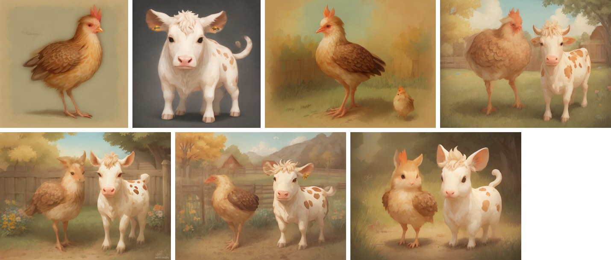

# StoryPix

**Turn a written story into a consistently illustrated storybook, with open models and no paid AI APIs.**

Write or paste a story, pick an illustration style, and StoryPix works out the scenes and the cast. It gives each
character a stable look and illustrates the story scene by scene, keeping characters recognisable through
reference-image conditioning. You can regenerate any scene with instructions ("make the hen happier"), compare
versions, and download single images, a ZIP or a PDF storybook.

Story understanding runs on four small PyTorch models trained in this repository. Images come from open diffusion
models run by StoryPix's own backend through Hugging Face Diffusers: SDXL-Lightning on an Apple-silicon or NVIDIA GPU,
or LCM-DreamShaper on a CPU-only server such as the free Hugging Face Space the public deployment uses.

```
Story ──▶ event units ──▶ Model A: scene boundaries ──▶ scenes (actions · setting · time · mood · composition)
      └─▶ Model B: character & place tagger ──▶ coreference ──▶ character profiles (+ uploaded references)
                                                                    │
     style instructions ──▶ token-aware prompt builder ◀────────────┘
                                   │
      character anchors ──▶ SDXL-Lightning (GPU) or LCM-DreamShaper (CPU) + IP-Adapter Plus (masked) ──▶ scene images
                                   │
          Model C: alignment · Model D: quality · DINOv2 identity consistency ──▶ auto-retry / best-of-k
                                   │
                         ordered storybook ──▶ PNG · ZIP (+ manifest) · PDF
```

**Live demo:** [storypics.vercel.app](https://storypics.vercel.app) — the backend sleeps when idle, so the first
visit can take about a minute to wake it.


*The example story generated by the live (CPU) deployment: two character portraits, then five scenes. Multi-character
scenes use masked reference conditioning; see the [ablation](docs/MODELS.md#ablation-how-to-condition-scenes-with-several-characters).*

## Highlights

- **Real scene understanding, not sentence counting.** Sentences are split into clause-level events with a dependency
  parse, and a trained Transformer boundary model (Model A) groups them into visual moments. On a hand-annotated gold
  set it beats the labelling-function heuristic, TextTiling and "every two sentences" (F1 0.678 vs 0.545 / 0.261 /
  0.429).
- **A consistent cast.** A trained BiLSTM-CRF tagger (Model B, F1 0.952 on children's stories, 0.980 with its lexicon
  backstop) finds characters and places, including first-person narrators. Coreference resolution and curated appearance priors then turn "a hen" into a canonical profile ("a hen with
  warm orange-brown feathers, a small red comb…"), and explicit story details ("a girl with red hair") always win.
- **Reference-conditioned images.** Each recurring character gets an anchor portrait first. Every scene is then
  conditioned on the anchors of the characters in it, through **IP-Adapter attention masks** that keep each reference
  in its own region. Prompts longer than CLIP's 77 tokens are chunk-encoded rather than silently truncated.
- **Measured quality.** Generated images are scored for text alignment (Model C), quality (Model D) and per-character
  identity similarity; weak scenes are automatically re-drawn with a new seed.
- **Production workflow.** Asynchronous jobs with SQLite persistence, live progress over Server-Sent Events,
  cancel/resume, per-scene regeneration with version history, and reproducible seeds and manifests.

## Deployment (free tier)

| Part | Where | Notes |
|---|---|---|
| Web app (Next.js) | Vercel, deployed from this GitHub repo on every push to `main` (root directory `frontend`) | static; `NEXT_PUBLIC_API_URL` points at the backend |
| Backend + all models | [Modal](https://modal.com) (`backend/modal_app.py`): one container that scales to zero | billed per second only while running, inside Modal's free monthly credits |

Nothing heavy is installed on a developer's machine. The backend image is built on Modal, and model weights download
into a Modal Volume on first start. The container shuts down after 4 idle minutes; the first request after an idle
period waits for it to start (about a minute), and the web app says so instead of failing.

Two backend modes, chosen at deploy time:

| Mode | Command | Images | Needs |
|---|---|---|---|
| CPU (current live demo) | `STORYPIX_MODAL_GPU=none modal deploy modal_app.py` | LCM-DreamShaper v7, 512 px, slower | free Modal account |
| GPU | `modal deploy modal_app.py` (T4) | SDXL-Lightning + IP-Adapter, ~1 MP, fast | a payment method on the Modal account (Modal requires one for any GPU, even when usage stays within the free credits; set a workspace budget) |

To deploy your own copy:

```bash
cd backend && .venv/bin/modal setup                         # once: log in to Modal in the browser
STORYPIX_MODAL_GPU=none .venv/bin/modal deploy modal_app.py # prints the backend URL
# then import the GitHub repo in Vercel: root directory "frontend", NEXT_PUBLIC_API_URL=<that URL>
```

`backend/Dockerfile` packages the same CPU profile for any other Docker host.

## Run it locally (optional; needs a GPU or Apple silicon)

Requirements: Python 3.11–3.13 (developed on 3.12 via [uv](https://github.com/astral-sh/uv)), Node 20+, about 20 GB
of free disk, and an Apple-silicon Mac with 16 GB or an NVIDIA GPU with 12 GB or more (see [Hardware](#hardware)).

```bash
make setup     # Python venv + backend deps, npm install
make models    # one-time download of ~12 GB of open model weights (resumable)
make backend   # API on http://localhost:8000   (docs at /docs)
make frontend  # app on http://localhost:3000
```

Without `make`:

```bash
cd backend
uv venv --python 3.12 .venv && uv pip install --python .venv/bin/python -r requirements-dev.txt
.venv/bin/python scripts/download_models.py
.venv/bin/uvicorn app.main:app --port 8000
# second terminal
cd frontend && npm install && npm run dev
```

Configuration is optional; see [`backend/.env.example`](backend/.env.example) (resolution, Lightning steps, retries, CORS)
and [`frontend/.env.example`](frontend/.env.example) (`NEXT_PUBLIC_API_URL`).

**Command line (same pipeline, no web UI):**

```bash
cd backend
.venv/bin/python -m app.cli analyze story.txt --scenes 5           # story understanding only, < 1 s
.venv/bin/python -m app.cli generate story.txt --style watercolor --out out/   # full storybook → out/storybook.pdf
```

## Hardware

| Machine | Works? | Notes |
|---|---|---|
| Apple silicon, 16 GB (M1–M4) | ✅ primary target | SDXL + Lightning (8 steps) on MPS; see [PERFORMANCE.md](docs/PERFORMANCE.md) for measured speed and memory |
| Apple silicon, 8 GB | ⚠️ | set `STORYPIX_IMAGE_RESOLUTION=768` and `STORYPIX_LIGHTNING_STEPS=4`; expect memory swapping |
| NVIDIA ≥ 12 GB VRAM | ✅ | defaults to the "quality" profile (28 steps, CFG, negative prompts) |
| Cloud CPU (Modal, 8 vCPU / 16 GB — the live demo) | ✅ | `lcm` profile: LCM-DreamShaper v7, 4 steps, 512 px, IP-Adapter Plus SD1.5, safety checker |
| Cloud GPU (Modal T4/L4) | ✅ | `lightning` profile with the safety checker (needs a payment method on Modal) |
| CPU-only laptop | ⚠️ | the `lcm` profile works, but SDXL profiles take minutes per image |
| No suitable GPU | ✅ notebook | [`notebooks/StoryPix_free_GPU.ipynb`](notebooks/StoryPix_free_GPU.ipynb) runs the batch pipeline on a free Colab/Kaggle T4 |

Story analysis and all four custom models run on any CPU in well under a second per story.

## Custom models

| Model | Architecture (trained layers on a frozen encoder) | Data | Result |
|---|---|---|---|
| **A** Scene boundaries | Transformer over MiniLM unit embeddings + discourse features | TinyStories, weak labels | gold F1 **0.678** · Pk 0.259 (heuristic 0.545 · 0.336) |
| **B** Characters & places | BiLSTM-CRF over MiniLM word states + casing/POS | LitBank (gold) + TinyStories (silver) | LitBank test F1 **0.745**; children's gold **0.952** (rules 0.904) |
| **C** Scene–image alignment | interaction MLP over SigLIP text/image embeddings | ImageRewardDB alignment ratings (1,018-image subset) | Spearman **0.25** vs zero-shot SigLIP −0.09 |
| **D** Image quality | fusion MLP over SigLIP + DINOv2 + OpenCV statistics | ImageRewardDB fidelity ratings (1,018-image subset) | Spearman **0.42** vs OpenCV baseline −0.03 |

Architectures, tensor shapes, losses, training details, baselines and dataset licences are in
**[docs/MODELS.md](docs/MODELS.md)**. To reproduce everything: `make data && make train && make evaluate`.

## Image generation stack

| Component | Licence | Role |
|---|---|---|
| Stable Diffusion XL base 1.0 | CreativeML OpenRAIL++-M | text-to-image backbone |
| SDXL-Lightning 4/8-step LoRA (ByteDance) | OpenRAIL++ | fast sampling on Apple silicon |
| IP-Adapter Plus SDXL, ViT-H (h94) | Apache-2.0 | character reference conditioning |
| SDXL VAE fp16-fix | MIT | stable fp16 decoding |
| LCM-DreamShaper v7 (SD1.5 family) | MIT | CPU-friendly 4-step generator (`lcm` profile, used by the deployment) |
| IP-Adapter Plus SD1.5, ViT-H (h94) | Apache-2.0 | character references for the `lcm` profile |
| Stable Diffusion safety checker | CreativeML OpenRAIL-M | blocks unsafe images on the public deployment |
| SigLIP base · DINOv2-small · all-MiniLM-L6-v2 | Apache-2.0 | frozen encoders for the custom models |

The model selection, including rejected options and why (SDXL-Turbo is non-commercial; FLUX and Z-Image are too large
for 16 GB or a free CPU), is documented in [docs/ARCHITECTURE.md](docs/ARCHITECTURE.md).

## Project layout

```
backend/
  app/            FastAPI app: api/ routes · schemas/ (Pydantic contracts) · models/ (PyTorch) · services/ (pipeline)
  training/       dataset download/preparation, training scripts, evaluate.py, annotations/ (gold sets)
  checkpoints/    trained weights + metrics + evaluation reports
  worker/         optional generation worker for a GPU machine you own
  scripts/        model download, Hugging Face Space deployment (CPU alternative)
  modal_app.py    Modal deployment (CPU or GPU) — the hosted backend
  Dockerfile      CPU-only image for any Docker host
  tests/          pytest: models, pipeline stages, API workflow
frontend/         Next.js 16 · TypeScript · Tailwind · shadcn/ui
notebooks/        free-GPU batch notebook
docs/             ARCHITECTURE · MODELS · API · PERFORMANCE
```

## Testing

```bash
(cd backend && .venv/bin/python -m pytest -q)       # 33 tests: CRF vs brute force, pipeline stages, job lifecycle
(cd backend && STORYPIX_RUN_INTEGRATION=1 .venv/bin/python -m pytest -k integration)  # +5: real Diffusers SDXL + LCM code, tiny models
(cd frontend && npm run lint && npm test && npm run build)
(cd frontend && node e2e/smoke.mjs ui)              # browser test in your installed Chrome (`full` = real storybook)
```

API tests use a clearly labelled **test double** for the image generator (`tests/conftest.py`), so the job workflow
can be tested without a GPU. The application never substitutes placeholder images: if the image model is
unavailable, generation requests fail with an explanation of how to fix it.

## Limitations

- Character consistency is strong for distinct characters but not perfect. Two characters of the same species, or very
  crowded scenes, are harder. Masked IP-Adapter conditioning assumes a left/right/thirds layout.
- Story understanding is tuned for narrative fiction in English, especially children's stories.
- Gold evaluation sets are small and single-annotated (see `backend/training/annotations/README.md`).
- The live demo runs on a CPU (no payment method needed), so its 512 px LCM-DreamShaper images are slower and less
  detailed than the SDXL images the same code produces on a GPU. The backend scales to zero, so the first visit after
  an idle period waits about a minute for it to start.
- Models C and D were trained on a 1,018-image subset of ImageRewardDB; treat their scores as indicative.
- Generated images follow the use restrictions of the CreativeML OpenRAIL licences.

## Documentation

- [docs/ARCHITECTURE.md](docs/ARCHITECTURE.md): design, model and dataset selection, hardware, MVP scope
- [docs/MODELS.md](docs/MODELS.md): the four custom models in detail
- [docs/API.md](docs/API.md): REST + SSE reference (interactive docs at `/docs`)
- [docs/PERFORMANCE.md](docs/PERFORMANCE.md): measured latency and memory
