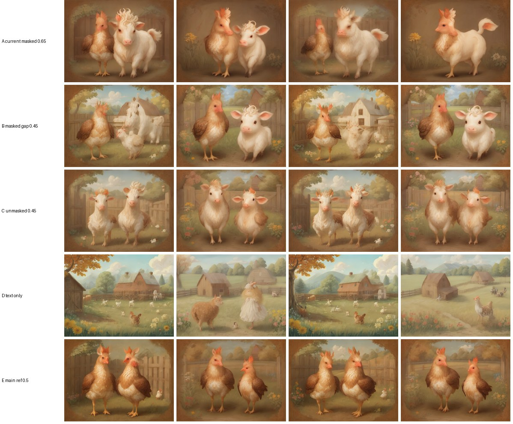

# StoryPix — Custom Models

StoryPix trains four task-specific PyTorch models. Each one sits on a **frozen, permissively licensed
pretrained encoder**. The layers on top are designed, trained and evaluated in this repository. Every model has
a reproducible training script, a checkpoint in `backend/checkpoints/`, a metrics file next to it, and an
evaluation against gold data **and** simple baselines (`python -m training.evaluate <task>`).

| | Model A | Model B | Model C | Model D |
|---|---|---|---|---|
| Task | scene boundary detection | character / place mention tagging | scene–image alignment | image quality |
| Frozen encoder | all-MiniLM-L6-v2 (sentences) | all-MiniLM-L6-v2 (words) | SigLIP base (text + image) | SigLIP base + DINOv2-small |
| Trained layers | Transformer encoder + pairwise head | BiLSTM + CRF | interaction MLP | fusion MLP |
| Trainable params | 1.49 M | 0.95 M | 1.18 M | 0.50 M |
| Training data | TinyStories (weak labels) | LitBank (gold) + TinyStories (silver) | ImageRewardDB | ImageRewardDB |
| Used for | splitting stories into scenes | building the cast | scoring / retrying images | scoring / retrying images |
| Train time (M4) | ~5 min (MPS) | ~2.5 min (CPU) | seconds (CPU) | seconds (CPU) |

Reproduce everything: `make data && make train && make evaluate` (from the repo root).

---

## Model A — Scene Boundary Detector

**Problem.** Split a story into *visually meaningful moments*. Splitting by sentence count is wrong: one sentence
can hold two pictures ("They became good friends and explored the farm together."), and three sentences can
describe one. StoryPix first splits sentences into clause-level **event units** using the dependency parse
(coordinated verb phrases become separate units). Model A then decides which units start a new scene.

**Architecture** (`app/models/scene_segmenter.py`):

```
unit i:  e_i = MiniLM(unit_text) ∈ R^384      f_i = discourse features ∈ R^17
x_i  = GELU(LayerNorm(W [e_i ; f_i])) + pos_i                         d = 256
h    = TransformerEncoder(x)   2 layers · 4 heads · pre-norm · FFN 512
p_i  = σ( MLP([h_{i-1}, h_i, |h_i − h_{i-1}|, h_i ⊙ h_{i-1}, cos(e_{i-1}, e_i)]) )   for i = 1..n-1
```

| Tensor | Shape | Meaning |
|---|---|---|
| `emb` | (B, N, 384) | frozen sentence embeddings of each unit |
| `feats` | (B, N, 17) | temporal cue, ending cue, time-of-day word, place mention/change, new character, character Jaccard with previous unit, dialogue flags, movement verb, stative verb, position, length, continuation flag |
| `mask` | (B, N) | real units |
| output | (B, N-1) | boundary logit before unit i |

**Decoding.** For a requested scene count *N*, take the N-1 most probable boundaries. This is exact for a
factorised boundary model. In *auto* mode, keep boundaries above a threshold calibrated on dev, then clamp to a
range set by story length. Two product rules sit on top of the model, are documented, and are applied only in
the app (not in the evaluation below):

1. The writer's own paragraph breaks raise a boundary's probability (noisy-OR, weight 0.6).
2. Very short stories (≤ 6 event units) illustrate every depictable event in auto mode.

**Data and supervision.** No commercially usable dataset labels scene boundaries in stories (ROCStories and VIST
have research-only terms). Model A is therefore trained with **weak supervision** on TinyStories V2-GPT4
(CDLA-Sharing-1.0):

* each story is flattened to one paragraph, as users usually paste it;
* labels come from the original **paragraph structure** (the writer's own beats), combined with labelling
  functions (strong temporal cues, place change plus movement, ending cues, dialogue turns) into soft targets;
* the model never sees paragraph information as input, so it must recover the beats from the text;
* refinement: paragraph breaks that only open a quoted line are down-weighted to 0.4 (a TinyStories formatting
  habit, not a scene change). This change was made once, after seeing that error type on the gold set.

Train / dev: 29,522 / 1,966 stories (578k / 38k unit transitions; 15% boundaries).

**Loss and training.** Binary cross-entropy against the soft labels. Feature dropout of 0.15 (whole feature columns)
stops the model from simply copying the labelling functions. AdamW (lr 3e-4, wd 0.01), warmup plus cosine schedule,
8 epochs, batch 32 stories, grad-clip 1.0. About 35 s/epoch on the M4 GPU (MPS).

**Evaluation** on the hand-annotated gold set: 38 stories, 124 boundaries, of which 24 are held-out TinyStories
stories and 14 were written or retold for StoryPix (`training/annotations/`). Pk and WindowDiff: lower is better.

| System | Mode | P | R | **F1** | Pk ↓ | WindowDiff ↓ |
|---|---|---|---|---|---|---|
| **Model A (trained)** | auto | 0.704 | 0.653 | **0.678** | **0.259** | **0.328** |
| Labelling-function heuristic | auto | 0.671 | 0.460 | 0.545 | 0.336 | 0.387 |
| Every 2 sentences | auto | 0.356 | 0.540 | 0.429 | 0.449 | 0.521 |
| TextTiling on MiniLM embeddings | auto | 0.223 | 0.315 | 0.261 | 0.494 | 0.613 |
| **Model A (trained)** | given gold N | 0.685 | 0.685 | **0.685** | **0.238** | **0.272** |
| Labelling-function heuristic | given gold N | 0.613 | 0.613 | 0.613 | 0.283 | 0.331 |
| Uniform spacing | given gold N | 0.347 | 0.347 | 0.347 | 0.371 | 0.401 |
| TextTiling on MiniLM embeddings | given gold N | 0.315 | 0.315 | 0.315 | 0.449 | 0.516 |

By source (auto-mode F1): on the 24 held-out TinyStories, Model A scores 0.667, against 0.500 for the heuristic and
0.327 for "every 2 sentences". On the 14 stories written for StoryPix, Model A and "every 2 sentences" tie at 0.698;
the annotator's own writing tends to put a new picture every two sentences, a bias the TinyStories half does not have.
The first trained version, before the dialogue-label refinement, scored F1 0.664 (auto) and 0.669 (given N). On the
weak dev labels (paragraph boundaries recovered from flattened text) the model reaches F1 ≈ 0.74. Character features
come from the production cast pipeline (Model B), so these numbers move slightly when Model B changes.

---

## Model B — Character & Place Mention Tagger

**Problem.** Find every mention of a character ("a lost little rabbit", "Captain Zoe", "the villagers") and every
place ("a deep green forest") so the resolver can build the cast. Lexicons alone miss unusual characters such as
"a curious robot" or "the zorb". A trained tagger generalises from context ("… said the zorb").

**Architecture** (`app/models/character_extractor.py`):

```
w_t   = MiniLM first-sub-token state ∈ R^384 (frozen)
c_t   = Embedding(casing class) ∈ R^16      (restores capitalisation lost by the uncased encoder)
u_t   = Embedding(spaCy UPOS) ∈ R^24
h     = BiLSTM([w ; c ; u])  hidden 192 × 2, dropout 0.3
e_t   = Linear(h_t) ∈ R^5   over tags O, B-CHAR, I-CHAR, B-PLACE, I-PLACE
tags  = Viterbi(CRF(e))     hand-written CRF with hard BIO constraints (no O→I-X, no B-X→I-Y)
```

| Tensor | Shape |
|---|---|
| `words` | (B, T, 384) |
| `case`, `pos` | (B, T) ints |
| `mask` | (B, T) |
| emissions | (B, T, 5) → Viterbi paths |

The CRF's forward algorithm and Viterbi decoder are unit-tested against brute-force enumeration
(`tests/test_models.py`).

**Data.**
* **LitBank** (CC BY 4.0): 100 public-domain novels, about 210k tokens. Nested entity layers are reduced to the
  outermost mention, then trimmed to the base noun phrase with spaCy. PER → CHAR; LOC/FAC/GPE → PLACE;
  pronoun-only spans are dropped (pronouns are resolved later). Split by book 80/10/10.
* **TinyStories silver labels**: the rule-based detector over 3,000 stories (48k sentences), for children's-story
  style. Each epoch mixes all LitBank sentences with a fresh 8k-sentence silver sample, so the larger silver set
  can't drown out the gold labels.

**Loss and training.** CRF negative log-likelihood; AdamW lr 2e-3, cosine schedule, 12 epochs, batch 32, grad-clip 5.
Model selection uses the mean span-F1 over LitBank dev and silver dev. About 10 s/epoch on CPU.

**Evaluation** (exact span match):

| Data | System | P | R | **F1** |
|---|---|---|---|---|
| LitBank test (held-out books, gold) | Model B | 0.741 | 0.749 | **0.745** (CHAR 0.783 · PLACE 0.656) |
| Children's stories (75 hand-annotated mentions) | Rule-based detector | 0.930 | 0.880 | 0.904 |
| Children's stories | **Model B** | 0.972 | 0.933 | **0.952** |
| Children's stories | Model B + lexicon backstop (production) | 0.974 | 0.987 | **0.980** |

The app runs Model B plus a lexicon backstop, which adds back known species and roles the tagger missed.

*History.* The first version (children's-story F1 0.896) had learned from silver labels in which toys, the sun and
the moon counted as characters, because the appearance knowledge base listed them. Stress-testing on new story types
exposed this. The objects were removed from the character lexicon (they become characters only when the tagger sees
them act), the silver labels were regenerated, and the model was retrained. The gold mention set was not changed.

**From mentions to a cast** (deterministic, `services/character_manager.py`):
* **Clustering.** Mentions are grouped by name, by species, through "X named Y" / appositive links, and through
  copular identity ("Lily was a curious little girl" merges into Lily).
* **Pronoun resolution.** Recency-based salience with gender/number agreement; "they" maps to the active group;
  "it" maps only to a recent non-human, otherwise it stays unresolved.
* **Participation.** "A letter from a kind old fisherman" mentions the fisherman without putting him in the scene.
* **Profiles.** Explicit details from the story ("with red hair", "a white hen") override curated appearance priors
  (`services/appearance.py`, about 100 species and roles). Open human details are picked deterministically per
  story, so regeneration keeps the same cast.

---

## Model C — Scene–Image Alignment

**Problem.** Score whether a generated image actually depicts its scene description, so StoryPix can retry or pick
the best candidate and show the user a meaningful score.

**Architecture** (`app/models/scene_alignment.py`):

```
i = SigLIP_image(img) ∈ R^768, t = SigLIP_text(description) ∈ R^768   (frozen, L2-normalised)
p_i = W_i i,  p_t = W_t t ∈ R^384
s = σ( MLP([p_i, p_t, p_i ⊙ p_t, |p_i − p_t|, 10·cos(i, t)]) )
```

**Data.** ImageRewardDB (Apache-2.0): images generated from real user prompts, each with a 1–7 human
**image–text alignment** rating, grouped by prompt. The dataset's own prompt-disjoint train / validation / test
folders are used, with a downloaded subset (see `training/datasets/download_data.py`).

**Loss.** MSE on the normalised rating, plus a Bradley–Terry pairwise loss over same-prompt image pairs with
different ratings, plus a **mismatch** term: the same image with a random other prompt is labelled 0. That last
term teaches the head to flag images showing the wrong content, the failure StoryPix most needs to catch.

**Baseline.** Zero-shot SigLIP cosine similarity. **Metrics.** Spearman ρ and Pearson r with human ratings,
within-prompt pairwise ranking accuracy, and right-prompt-versus-random-prompt accuracy.

**Data actually used.** The project's bandwidth and disk budget allowed one ImageRewardDB image archive
(`validation_2`, 1,018 images). It was split by prompt into 693 train, 160 dev and 165 test images (70/15/15, no
prompt shared between splits). The training script handles the dataset's full train/validation/test folders when more
archives are downloaded; these numbers are small-sample estimates, not a benchmark result.

| System (165 test images) | Spearman ρ | Pearson r | Within-prompt pairwise acc. | Right vs random prompt |
|---|---|---|---|---|
| Zero-shot SigLIP cosine | −0.089 | 0.042 | 0.548 | **0.952** |
| **Model C (trained head)** | **0.251** | **0.300** | **0.605** | 0.933 |

Zero-shot SigLIP is already good at the coarse question (right prompt vs. a random one) but does not track how
humans grade *degrees* of alignment between near-misses; the trained head does, modestly.

---

## Model D — Image Quality Evaluator

**Problem.** Predict perceived fidelity: anatomy, artifacts, coherence.

**Architecture** (`app/models/quality_evaluator.py`):

```
SigLIP image embedding (768) ─┐
DINOv2-small CLS (384)        ├─ LayerNorm → Linear(256) → GELU  (per source) → concat → MLP → σ
OpenCV statistics (6)         ┘   sharpness, contrast, colourfulness, entropy, exposure, clipping
```

**Data and loss.** ImageRewardDB **fidelity** ratings (same 693/160/165 prompt-disjoint split as Model C); MSE plus
within-prompt Bradley–Terry ranking loss. **Baseline.** A linear model on the OpenCV statistics alone.

| System (165 test images) | Spearman ρ | Pearson r | Within-prompt pairwise acc. |
|---|---|---|---|
| OpenCV statistics (linear) | −0.025 | 0.063 | 0.471 |
| **Model D (trained head)** | **0.423** | **0.481** | **0.681** |

---

## Ablation: how to condition scenes with several characters

Run on the deployed CPU profile (LCM-DreamShaper v7 + IP-Adapter Plus SD1.5, 640×480, 4 steps): two two-character
scenes from the example story ("The hen meets the cow", "Exploring the farm"), two seeds each, identical prompts.



| Variant | What happened |
|---|---|
| A — references masked to overlapping halves, strength 0.65 (first design) | the hen and cow merge into hen-cow hybrids; one sample is a single fused creature |
| **B — masks with a central gap, strength 0.45 (adopted)** | **two distinct characters, each recognisably its anchor** |
| C — both references over the whole canvas, strength 0.45 | both animals become identical hybrids (the references are averaged) |
| D — text only (descriptors in the prompt, no references) | no consistency at all: tiny or wrong animals dominated by scenery |
| E — only the main character's reference | two hens; the cow disappears |

Text descriptions alone do not keep characters consistent (D), and references help only when each is confined to its
own region with a gap and moderate strength (B vs A/C). With the adopted settings, two of the four two-character
scenes in the example storybook are clean and two still show partial attribute bleeding on the smaller SD1.5-class
model, as does a third character without an anchor (the rabbit). SDXL on a GPU, the same code with
`modal deploy modal_app.py`, is the stronger option for crowded scenes.

## Character identity consistency (not a trained model)

StoryPix measures whether a character still looks like its reference portrait. It computes cosine similarity
between DINOv2-small embeddings of the anchor portrait and of the character's region in the scene, using the same
left/right/thirds regions as the masked IP-Adapter conditioning. This is a **zero-shot metric**, labelled that
way in the API (`scores.consistency`) and the UI.

## How the scores are used

`overall = 0.45 · alignment + 0.25 · quality + 0.30 · mean(consistency)`, re-weighted over whichever scores are
available. If a scene's overall score is below `STORYPIX_RETRY_BELOW_SCORE` (default 0.45), it is regenerated with a
new seed (up to `STORYPIX_MAX_RETRIES`) and the best candidate is kept. With `STORYPIX_CANDIDATES_PER_SCENE > 1`,
every scene is best-of-k, which is recommended only on a fast GPU.

## Licences and attribution

* TinyStories, Eldan & Li 2023: CDLA-Sharing-1.0. Trained weights are "Results" under CDLA and are not share-alike.
* LitBank, Bamman et al. 2019 (*An annotated dataset of literary entities*, NAACL): CC BY 4.0.
* ImageRewardDB, Xu et al. 2023 (*ImageReward*, NeurIPS): Apache-2.0.
* Encoders: all-MiniLM-L6-v2 (Apache-2.0), SigLIP base patch16-224 (Apache-2.0), DINOv2-small (Apache-2.0).
* spaCy `en_core_web_sm` (MIT), lemminflect (MIT).
